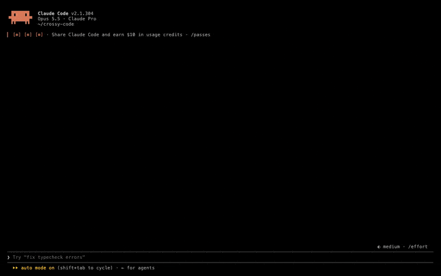

# crossy-code

`/crossy-code` opens a Crossy Road style game in a pane. It is drawn as a voxel world in the terminal.
A small software renderer draws boxes with shadows, lighting and antialiasing, two pixels to a cell.



[Video](https://github.com/samlevine03/crossy-code/releases/download/demo/crossy-code.mp4). The run is played by a demo autopilot, see [demo/README.md](demo/README.md).

## How it works

Crossy Code is a Claude Code mod: a plugin whose hooks module, `hooks/register.tsx`, registers the
`/crossy-code` command and opens a pane beside the chat that holds a `Raster`, a grid of colored terminal cells.
About 30 times a second a frame loop steps the game and rasterizes the voxel world in plain TypeScript, into a
z-buffer with a shadow map, then blits the result to the pane as half-block characters, two pixels to a cell.
There is no game engine, WebGL or native code: keys arrive as pane hotkeys, the save lives in the plugin's store,
and everything on screen is boxes from `hooks/models.ts`.

## Install

This repository is its own plugin marketplace:

```bash
claude plugin marketplace add samlevine03/crossy-code
claude plugin install crossy-code@crossy-code
```

Or, inside a session: `/plugin marketplace add samlevine03/crossy-code`, then `/plugin install crossy-code@crossy-code`.

## Keys

The pane takes keys while it has focus.

- `w` `a` `s` `d` hop. The arrow keys and `h` `j` `k` `l` work once the status line is clicked.
- `p` pauses. The game also pauses when the pane loses focus.
- `c` opens the character picker. `a` and `d` browse, `w` buys or picks.
- `r` starts over. `f` shows frames per second, render time and supersampling. `q` or `esc` closes the pane.

## Characters

Tokens appear on grass and roads. They buy characters:

| Character | Tokens |
| --- | --- |
| Clawd | free |
| Rubber Duck | 50 |
| Ferris | 100 |
| CI Bot | 100 |
| Cold Brew | 150 |
| Save Icon | 150 |
| Kernel Hacker | 200 |
| Zombie Process | 300 |

Top score, tokens, characters and death counts are saved to the plugin store and carry across sessions.

## Rendering

The renderer redraws the whole world each frame, at about 30 frames per second:

- shadows from a fixed sun
- per-face lighting
- water that ripples and flows with the logs
- up to 3x supersampling, which drops a level when frames run slow

The terminal paints at most 1024 color pairs a frame. Each frame is rounded to 4 bits a channel,
and the rarest pairs merge into their nearest neighbor so the score and banners stay sharp.

The game needs a truecolor terminal, such as iTerm2, Ghostty, WezTerm, kitty or Windows Terminal. In other
terminals the colors come out wrong. In tmux, set `COLORTERM=truecolor` and `set -as terminal-features ',*:RGB'`.
On other surfaces the pane shows a note to open it in the terminal.

## Development

```
claude plugin validate .
claude plugin test .
```

See [CONTRIBUTING.md](CONTRIBUTING.md) before opening an issue or pull request.

## Disclaimer

Crossy Code is an unofficial fan project and a parody. It is not affiliated with or endorsed by Hipster Whale,
the makers of Crossy Road, or by Anthropic. Crossy Road is a trademark of Hipster Whale. Claude, Claude Code
and Clawd belong to Anthropic.

No code, art, models or sound from Crossy Road are used. The game rules, the renderer, the font and every
voxel model were written with Claude Code "from scratch" in this repository. Ferris, the Rust crab, is in the public domain.

## License

MIT, see [LICENSE](LICENSE).
